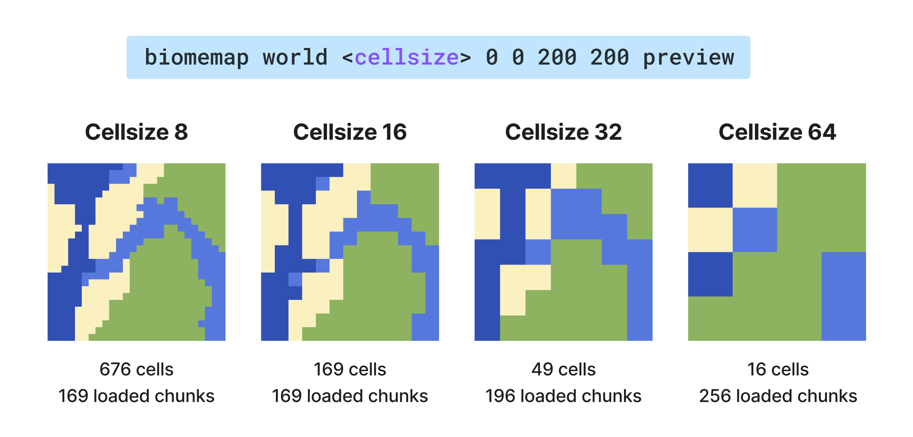

<div align="center">

# BiomeMap

Generates a lightweight JSON file mapping each world region to its dominant biome. Ideal for creating stylized biome maps on external web apps.

</div>

## 📋 Overview

BiomeMap exports the dominant biome of a rectangular selection.
You choose a world and 2 corners (`x/z`), and the plugin builds a grid of cells over that area.  
Then it samples biomes and writes:
- a JSON file
- optionally a PNG preview (`1 pixel = 1 cell`)

## ✨ Features

- Rectangular selection defined by two coordinates (`/biomemap world x1 z1 x2 z2 [cellSize] [preview]`)
- Cell size with chunk-friendly alignment (`4`, `8`, `16`, `32`, ...)
- Chunk-based sampling to smooth biome transitions
- Asynchronous processing with frequent progress updates (no server freeze)
- One export at a time (global lock)
- Stop command to cancel running exports cleanly
- Structured JSON output with min/max bounds per cell and namespaced biome IDs
- Optional PNG preview output (`1 pixel = 1 cell`) using a biome RGB palette

## 🚀 Installation

1. Install [PaperMC server](https://papermc.io/downloads/paper) with Java 25+
2. Download the latest `biomemap-x.x.x+mcx.x.x.jar` from the [releases page](https://github.com/Sukikui/BiomeMap/releases)
3. Drop the jar into your server’s `plugins/` folder
4. Restart the server or run `/reload confirm`

## 🕹 Command Usage

Only one export can run at a time.

All commands and tab completion require `biomemap.admin`, granted to server operators
and the console by default. A permissions plugin can grant or revoke this administrator permission.

### Commands

| Command | Description |
| --- | --- |
| `/biomemap <world> <x1> <z1> <x2> <z2> [cellSize] [preview]` | Starts a biome export (JSON + optional PNG). |
| `/biomemap status [map]` | Shows current progress, ETA, outputs. Add `map` for compact ASCII completion map. |
| `/biomemap stop` | Stops the current export and removes files from that run in `exports/`. |

### Arguments

| Argument | Required | Description |
| --- | --- | --- |
| `<world>` | Yes | World name, for example `world` or `world_nether`. |
| `<x1> <z1>` | Yes | First corner of the area. |
| `<x2> <z2>` | Yes | Opposite corner of the area. |
| `[cellSize]` | No | Cell size in blocks. Default `16` (common values: `4`, `8`, `16`, `32`, `64`, ...). |
| `[preview]` | No | Add `preview` to generate a PNG (`1 pixel = 1 cell`). |


### `cellSize` resolutions



## 📁 Output files

All files are written to `plugins/BiomeMap/exports/`.

| File | Pattern | Created when |
| --- | --- | --- |
| JSON | `<world>_<cellSize>_<index>.json` | Always |
| PNG | `<world>_<cellSize>_<index>.png` | Only if `preview` is used |

Rules:
- `index` starts at `1` and increases if either the JSON or PNG filename already exists.
- If you run `/biomemap stop`, files from the canceled export are removed.
- Files are staged as `.biomemap-*.tmp` files, then published complete without overwriting existing files. The export filesystem must support hard links.
- PNG is published before JSON; the pair is not atomic. A crash may leave temporary files or an orphaned complete PNG.

## ⚙️ Configuration

[`config.yml`](src/main/resources/config.yml) exposes performance throttles and missing-terrain handling.

| Key | Default | Description |
| --- | --- | --- |
| `performance.chunks-per-tick` | `4` | How many new chunk jobs are started each tick. Lower = safer, slower. |
| `performance.max-in-flight` | `16` | Max number of BiomeMap jobs currently in pipeline (queued/running). |
| `export.missing-chunks` | `error` | `error`: reject before exporting if any required chunk is ungenerated. `unknown`: mark affected cells as `minecraft:unknown` (magenta in PNG). `generate`: generate missing terrain. |

Quick tuning guide:
- If players feel lag, lower `max-in-flight` or `chunks-per-tick`.
- If export feels too slow but server is stable, increase `chunks-per-tick` a bit.
- `max-in-flight` remains the concurrency cap even if `chunks-per-tick` is higher.

Older configurations may still contain `performance.max-concurrent-chunks`. During migration,
the smaller of the old and new concurrency caps is used, with a warning in the server log.
Set `max-in-flight` to that effective value and remove the old key.

The `error` mode verifies chunks progressively; use `/biomemap status [map]` to monitor it
or `/biomemap stop` to cancel. Restart the server after changing configuration.

Selections whose aligned coordinates or backing array sizes cannot be represented are rejected
before allocation or chunk loading. There are no configurable size caps: a very large valid
selection can still exceed the server's available memory.

## 🗺 JSON Format

```json
{
  "cellSize": 16,
  "selectionMin": { "x": -200, "z": -200 },
  "selectionMax": { "x": -50, "z": -20 },
  "gridOrigin": { "x": -208, "z": -208 },
  "width": 10,
  "height": 12,
  "cells": [
    {
      "i": 0,
      "j": 0,
      "bounds": {
        "min": { "x": -208, "z": -208 },
        "max": { "x": -193, "z": -193 }
      },
      "biome": "minecraft:plains"
    },
    {
      "i": 1,
      "j": 0,
      "bounds": {
        "min": { "x": -192, "z": -208 },
        "max": { "x": -177, "z": -193 }
      },
      "biome": "minecraft:forest"
    }
  ]
}
```

| Field | Type | Description |
| --- | --- | --- |
| `cellSize` | `number` | Cell size in blocks (minimum 4; values above that are aligned to the chunk grid). |
| `selectionMin/Max` | `object` | Raw coordinates provided in the command. |
| `gridOrigin` | `object` | North-west corner of the grid (min X, min Z). |
| `width`, `height` | `number` | Number of cells on the X and Z axes. |
| `cells[].bounds.min/max` | `object` | Inclusive bounds delimiting the cell. |
| `cells[].biome` | `string` | Namespaced biome ID (e.g. `minecraft:savanna`). |

---

<div align="center">
Crafted by

Sukikui
</div>
